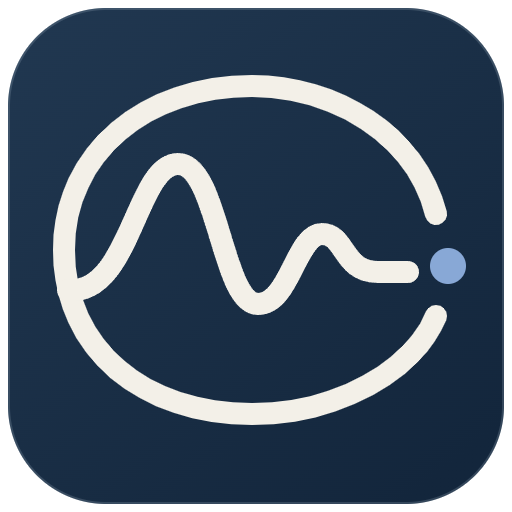

<p align="center"></p>
<h1 align="center">CtrlVista · 控小助</h1>
<p align="center">AI-Assisted Control Experiment Workbench</p>
<p align="center">看见响应，理解控制。<br>See the response. Understand the control.</p>

面向自动化及相关专业学生的 Windows 桌面控制实验工作台。通过手动调参、实际仿真、方案对比和经过计算验证的 AI 建议，理解控制现象并保存可复现的实验过程。

A Windows desktop workbench for learning control systems through interactive simulation, PID tuning, and simulation-verified AI suggestions.

[下载安装包](https://github.com/txflj/CtrlVista-/releases/tag/v3.0.0) · [开发说明](docs/DEVELOPMENT.md) · [计算方法](docs/COMPUTATION.md) · [第三方资源](THIRD_PARTY.md)

## 下载与使用

在 [Releases](https://github.com/txflj/CtrlVista-/releases) 下载 `CtrlVista-3.0.0-Setup-win-x64.exe`，双击安装，通过桌面「控小助」启动。安装包包含运行环境，不需要部署网站或安装 Node.js、Python。

首次使用建议选择「电机调速」：理解任务 → 尝试调参 → 运行仿真 → 观察指标 → 比较方案 → 保存实验。AI 助手需要在软件设置中填写兼容 API 地址、模型名称和自己的密钥；没有密钥也能完成本地实验。默认提供 DeepSeek 配置入口。

实验记录保存在本机，支持 JSON 备份与重新导入。模型密钥不进入实验导出文件。调用在线模型时会发送当前请求所需的实验上下文，详见 [AI 与数据边界](docs/AI_AND_DATA.md)。

## 四个实验

| 实验 | 学习重点 |
|---|---|
| 电机调速 | 比例、积分与响应速度及稳态误差的取舍 |
| 机械定位 | 二阶动态、阻尼、超调与振荡 |
| 温度调节 | 目标跟踪、扰动抑制与恢复 |
| 综合挑战 | 限定参数范围内的多目标设计与比较 |

## 核心功能

- P、PI、PID 控制；输出、目标、误差与控制作用曲线。
- 超调、调节时间、稳态误差、扰动恢复及控制峰值评价，显示达标、未达标或无法判定。
- AI 提出候选后调用计算工具验证，每次最多验证三组，经用户选择才应用。
- 自动整定作为独立对照；蓝色当前曲线与紫色固定对照便于观察修改效果。
- 引导实验与自由探索；运行记录、预测、笔记、复盘及复算核对。
- JSON 实验包、CSV 曲线及 HTML 小结导出。
- 程序化三维信号匣、独立傅里叶演示、收敛环欢迎段、浅深色主题与可关闭的声音。

## 从源码运行

建议使用 Windows、Node.js 24 和 npm。

```powershell
npm ci
npm test
npm run build
npm start
```

完整桌面功能由 Electron 提供。`npm run dev` 仅启动界面开发服务，不提供桌面文件与模型请求桥。

桌面自动检查另需安装 Playwright：`npm install --no-save playwright`，也可通过 `KX_PLAYWRIGHT_PATH` 指定其安装位置。安装器构建需要 PowerShell 7 与 Inno Setup，详见 [开发说明](docs/DEVELOPMENT.md) 和 [桌面安装说明](docs/DESKTOP_INSTALL.md)。

## 范围与验证

- 自定义对象支持连续、稳定、单输入单输出、实系数严格真有理、最高三阶、正稳态增益的模型。
- 教学模型不替代真实硬件试验，不支持纯滞后、离散或多变量控制。
- 自动整定使用有限预算搜索，不保证全局最优；AI 自由文字解释仍需核对。
- 主页的傅里叶演示采用独立合成信号，与实验台的 PID 仿真数据分开。
- 3.0.0 已完成 72 项单元测试、88 项发行桌面检查及新装、升级验证。具体条件和边界见 [验证记录](docs/VALIDATION.md)。本机模拟接口检查不代表真实模型联测或教学效果研究。

## 项目结构

| 目录 | 内容 |
|---|---|
| `src/core` | 模型、数值仿真、指标、搜索与案例 |
| `src/ui/control-lab` | 参数、曲线、AI 助手与实验状态 |
| `src/app` | 应用外壳、欢迎段与主页桥接 |
| `src/homepage` | 三维入口、信号匣与傅里叶演示 |
| `desktop` | Electron 生命周期、本机存储、计算线程与模型请求 |
| `tests`、`scripts`、`evidence` | 测试、构建与验证记录 |

## 许可证与致谢

本项目自主编写的代码采用 [MIT License](LICENSE)，允许在遵守许可的情况下使用、修改和再分发；第三方部分保留原有版权与许可。

主页的场景组织、阵列交互、部分动效、合成音效与《观测室》配乐基于 [LBEILC/RhineLabUI](https://github.com/LBEILC/RhineLabUI) 的 MIT 授权内容改编。当前信号匣几何、控制实验业务、计算验证闭环及品牌欢迎接入由本项目实现。完整复用范围、固定提交与排除资源见 [NOTICE](NOTICE)、[第三方资源清单](THIRD_PARTY.md) 和 [上游说明](third-party/RhineLabUI/NOTICE.md)。不将上述第三方内容声明为本项目原创。

项目使用 AI 辅助开发、设计和自动检查；验证证据的适用范围如实记录。

## 反馈与贡献

欢迎通过 [Issues](https://github.com/txflj/CtrlVista-/issues) 提交问题。请说明软件版本、实验名称、操作步骤、预期与实际结果；可附去除个人信息后的实验包。不要上传 API 密钥或个人配置目录。

首次公开从当前 3.0.0 源码快照开始，详见 [开源发布说明](docs/OPEN_SOURCE.md)。
